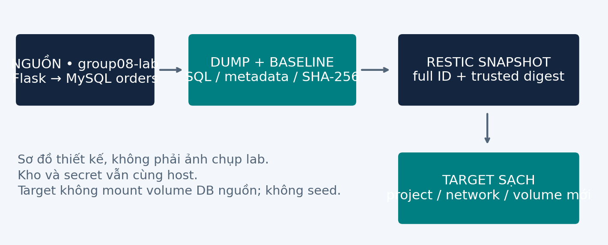
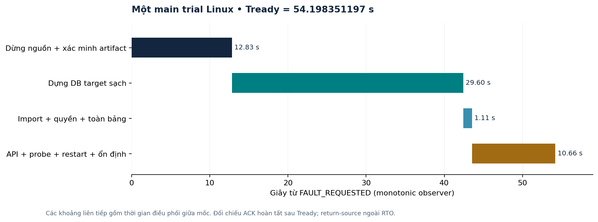

# ĐÁNH GIÁ KHẢ NĂNG PHỤC HỒI TRƯỚC SỰ CỐ MÃ HÓA TỐNG TIỀN BẰNG MÔ PHỎNG AN TOÀN

**Báo cáo tổng hợp kỹ thuật — Nhóm 08**

Thành viên: Đa Minh, Minh Quân. Thời lượng kế hoạch: 6 tuần.

Ngày tổng hợp: 15/11/2026. Môi trường hướng tới: Windows 10/Docker Desktop.
Môi trường có bằng chứng chạy thật trong hồ sơ: Linux/cloud với Linux containers.

Repository: https://github.com/daminh12/MaNhom08_DanhGiaKhaNangPhucHoiRansomware

**Trạng thái nộp review:** Có mã nguồn, kết quả thực nghiệm Linux và bộ hồ sơ
tổng hợp. Chưa nghiệm thu đầy đủ Phase 6/Windows hoặc xác nhận đạt RTO/RPO mục
tiêu. Tài liệu này không phải biên bản ký xác nhận của thành viên/giảng viên.

## 1. Tóm tắt và cách đọc kết quả

Dự án xây dựng một lab đơn hàng tổng hợp để đánh giá một chuỗi phục hồi có thể
kiểm chứng: ứng dụng Flask ghi MySQL, database được dump nhất quán, artifact được
bảo vệ bằng manifest SHA-256 và snapshot Restic, sau đó phục hồi sang stack sạch.
Sự cố được tạo bằng thao tác dừng service trong lab. Không sử dụng mã độc, mã hóa
tống tiền thật, xóa bảng hoặc xóa volume để gây sự cố.

Bằng chứng Linux cho thấy chuỗi backup–clean restore đã hoạt động trong phạm vi
đã thử. Main trial ngày 10/11/2026 phục hồi đúng 105 dòng của snapshot, kiểm schema,
toàn bộ nội dung, quyền, API đọc/ghi và dữ liệu sau restart. Một probe ghi sau
xác minh được tách riêng. Ba đơn có ACK sau snapshot chưa được phục hồi; checkpoint
có ACK trước snapshot được phục hồi. Kết quả này phù hợp phạm vi snapshot, không
là sai lệch SHA-256 của dữ liệu đã khôi phục.

Observed RTO của một main trial là **54.198351197 giây**, tính bằng monotonic của
cùng observer. Khoảng tuổi commit cuối được phục hồi suy từ send/ACK là
**10.518407983–10.532435583 giây**. Khoảng này không phải exact RPO. Nhóm chưa chốt
RTO/RPO objective nên không kết luận đạt SLA. Chỉ có một main sample trên cloud
VFS, image cached; không tính trung bình hoặc độ tin cậy từ các kịch bản khác nhau.

| Cách ghi | Ý nghĩa trong báo cáo |
|---|---|
| PASS | Điều kiện cụ thể đã đạt trong môi trường và lượt có dẫn chứng |
| FAIL / FAILED | Điều kiện chưa đạt hoặc lượt thất bại được giữ nguyên |
| NOT TESTED | Chưa có phép chạy/bằng chứng đủ để kết luận |
| N/A | Không áp dụng, ví dụ RPO cho negative test không có outage |

Phase 6 đã review runbook v1.0, chạy các control an toàn và tạo v1.1. Resource gate
từ chối clean restore mới vì disk gần đầy; các mục Windows và lượt Minh Quân chạy
độc lập vẫn NOT TESTED. Phase 7 tổng hợp hồ sơ và kiểm tính nhất quán, không biến
những phần chưa thử thành PASS. Nhật ký kiểm tra tự động trên Linux/cloud không được gán là
hai thành viên đã trực tiếp thao tác trên máy Windows.

## 2. Câu hỏi nghiên cứu, lý thuyết và phạm vi

### 2.1. Câu hỏi và tiêu chí kỹ thuật

Câu hỏi chính là: khi dịch vụ dữ liệu không khả dụng, nhóm có thể chọn đúng một
bản sao lưu, kiểm tra đầu vào, phục hồi sang môi trường sạch và xác nhận dịch vụ
hoạt động với dữ liệu đúng đến đâu? Câu hỏi phụ gồm thời gian quan sát để dịch vụ
ready, dữ liệu có ACK nào thiếu sau restore, và runbook có đủ rõ để người khác
lặp lại mà không làm hỏng bằng chứng hay ghi đè target dở hay không.

Điều kiện kỹ thuật không dừng ở “container chạy” hoặc “COUNT bằng nhau”. Một lượt
restore phải có target độc lập, import thành công, schema và toàn bộ nội dung
khớp baseline của snapshot, quyền ứng dụng đúng, API đọc/ghi và persistence qua
restart. Số đo phải truy được về sự kiện gốc; thiếu dữ liệu không được thay bằng 0.

### 2.2. Liên hệ với ransomware

Ransomware có thể làm dữ liệu/dịch vụ không truy cập được và đe dọa cả bản sao lưu.
Vì vậy, phục hồi từ bản sao tin cậy và kiểm dữ liệu sau restore là một phần của
khả năng phục hồi. RaaS, truy cập ban đầu, tống tiền kép và exfiltration chỉ là
bối cảnh lý thuyết của đề tài, không phải hành vi đã triển khai trong lab.

Trong dự án, dừng MySQL tạo một tác động mất khả dụng có thể đảo ngược. Việc dùng
volume mới thay vì đọc lại volume nguồn giúp kiểm tra chuỗi phục hồi thực sự dựa
vào artifact backup. Tuy nhiên, phép thử này không chứng minh phát hiện mã độc,
ngăn mã hóa, chống sửa/xóa kho bởi host admin, chống lộ secret hoặc phục hồi sau
mất toàn bộ host. Không suy rộng kết quả sang host compromise hoặc ransomware thật.

### 2.3. Khung ứng phó và chiến lược backup

SANS PICERL được dùng làm cách tổ chức Preparation, Identification, Containment,
Eradication, Recovery và Lessons Learned. NIST SP 800-61 Rev. 3 đặt ứng phó sự cố
trong quản lý rủi ro theo CSF 2.0. Trong lab, chuẩn bị backup/role/runbook, ghi nhận
unavailable, ngừng ghi, restore và rút kinh nghiệm là các hoạt động được liên hệ
với những khung đó; đây không là đánh giá tuân thủ đầy đủ một tiêu chuẩn.

Quy tắc 3-2-1, bản sao offsite, offline và immutable là các hướng thiết kế lý
thuyết. Hệ thống hiện có tài khoản backup và secret riêng, nhưng kho Restic,
password, dữ liệu nguồn và observer vẫn cùng host. Khác thư mục không tạo ra
thiết bị/vị trí độc lập. Không tuyên bố lab đã triển khai 3-2-1 hoặc air-gap.

### 2.4. Ràng buộc an toàn và điều kiện vận hành

Mọi dữ liệu là đơn hàng giả có alias LAB-. Database là lab_config, table orders,
engine InnoDB. Không đưa dữ liệu cá nhân vào lab. Chỉ một người điều khiển cửa sổ
đo; không có writer, backup cũ, Task Scheduler, admin transaction hoặc DDL khác.
Profile producer là tuần tự, không retry; yêu cầu có kết quả commit chưa rõ làm
dừng phép thử và giữ bằng chứng để điều tra.

Các script recovery hiện yêu cầu nguồn running/healthy khi bắt đầu để tạo diễn
tập có kiểm soát. Đây chưa là entrypoint phục hồi cho sự cố nguồn đã hỏng từ
trước. Không bỏ gate hoặc import vào nguồn để vượt giới hạn này. Mọi target dở,
result FAILED, snapshot và volume phải được giữ theo quy trình, không xóa để làm
lại kết quả đẹp hơn.

## 3. Yêu cầu và truy vết qua các phase

### 3.1. Chuỗi yêu cầu tối thiểu

MVP được chia thành lab, consistent backup, clean restore, benign outage,
measurement, runbook rehearsal và hồ sơ tổng hợp. Mỗi phase phải chỉ ra file,
cách chạy, điều kiện đạt, evidence và giới hạn. Có code là điều kiện cần; có
backup PASS không tự chứng minh restore PASS. Review cũng tách verifier prototype
trên nhánh audit khỏi verifier Phase 2 đang dùng trong workflow hiện hành.

| Nhóm yêu cầu | Thành phần chính | Bằng chứng tiêu biểu | Trạng thái có giới hạn |
|---|---|---|---|
| Web/DB giả, health, quyền | compose.yaml, app và database scripts | Phase 1 runtime/seed/grants/browser | PASS Linux; Windows NOT TESTED |
| Backup nhất quán và snapshot | db_dump.sh, backup.py | Phase 2 successful-runs/integration | PASS các run Linux đã thử |
| Clean restore | compose.restore.yaml, recovery controller/archive/common | Phase 3 clean-result/events | PASS lịch sử Linux |
| Toàn vẹn và nghiệp vụ | Manifest SHA, schema/all-row baseline, API/probe/restart | Phase 3/4 và retained integrity Phase 5 | PASS phạm vi đã ghi |
| Outage và phục vụ lại URL | Controller drill/web-outage | Phase 4 main/control raw events | PASS một main trial Linux |
| Metrics và CSV | SOURCE/metrics/ | Phase 5 CSV/JSON/manifest | PASS corpus lịch sử, chưa SLA |
| Runbook độc lập/Windows | Runbook v1.1, PowerShell launcher | Phase 6 partial controls và resource gate | Nghiệm thu đầy đủ NOT TESTED |
| Word/PPTX tổng hợp | Báo cáo, slide và kiểm artifact Phase 7 | Hồ sơ kiểm định artifact riêng | Không thay nghiệm thu runtime còn thiếu |

### 3.2. Tình trạng theo phase

| Phase | Đã có | Điểm còn thiếu |
|---|---|---|
| 0 | Audit/review, nhận diện prototype và module chưa có | Prototype verifier không nằm trong pipeline hiện hành; chưa đóng finding bằng một module khác |
| 1 | Flask/MySQL/Compose, fake seed, API, health, UI và runtime Linux | Bootstrap và toàn bộ workflow Windows thật |
| 2 | Hai backup PASS, SHA, Restic readback; unit và negative integration | Scheduler/PowerShell native, xử lý finding entrypoint cũ |
| 3 | Clean restore Linux, full schema/data/grants/API/restart; giữ run FAILED | SQL interruption thật và restore Windows |
| 4 | Main/control/corrupt guard Linux có raw evidence | Nhiều main repeats, real lost-ACK retry, host/repo-loss độc lập |
| 5 | Tính lại corpus, retained-DB/Restic check ngày 10/11, CSV có pin/hash | Exact RPO/targets/three-trial statistics; chưa có objective |
| 6 | Review v1.0, control Linux, uncertain-response fix, v1.1 | Disk, clean rehearsal mới, Windows và Minh Quân chạy độc lập |
| 7 | Biên soạn/review hồ sơ báo cáo và slide | Nghiệm thu artifact theo log Phase 7; kỹ thuật thiếu ở Phase 6 vẫn pending |

Truy vết, nhật ký và phân công được tổng hợp ở BAO_CAO_CAC_PHASE.md; owner là đề xuất chưa ký xác nhận. Main/PR có thể khác nhau về phần
đã tích hợp, vì vậy người chạy phải ghi branch và commit thực tế. Không gọi các
phần trên nhánh draft là đã merge main hoặc đã được nhóm phê duyệt.

## 4. Kiến trúc và mô hình dữ liệu



### 4.1. Thành phần nguồn và bề mặt truy cập

Compose project nguồn là group08-lab, gồm web Flask/Gunicorn và MySQL 8.4.7.
Web mặc định tại http://127.0.0.1:8080/, backend MySQL chỉ nối network lab nội bộ
và không publish port DB ra host. Web có thêm frontend bridge để publish cổng;
bridge này không chặn outbound Internet, nên topology không chứng minh air-gap.

Ứng dụng chạy uid không phải root, filesystem read-only, tmpfs cho /tmp và giảm
capability. App chỉ được SELECT/INSERT trên lab_config.orders. Secret được mount
dưới dạng file, Git bỏ qua; quyền Docker/host vẫn có thể truy cập các tài nguyên
này. Đây là hardening phù hợp lab, không là ranh giới chống host admin đã bị chiếm.

### 4.2. Dữ liệu và API

orders có sáu cột: id, customer_alias, product_name, quantity, unit_price_vnd và
created_at_utc. Giá dùng số nguyên VND, sản phẩm chỉ Notebook/Pen/Folder, alias
dạng LAB-. Các ràng buộc đầu vào và CHECK của database giảm dữ liệu ngoài phạm
vi lab. Timestamp dùng UTC, nhưng không phải chứng cứ độc lập thời điểm commit.

MySQL seed 100 dòng chỉ trong lần tạo volume nguồn rỗng. Những lần tạo đơn thử
làm count tăng là hợp lệ; không xóa dữ liệu để đưa về 100. GET /api/orders trả
tối đa 100 dòng mới nhất và tổng count, do đó API chỉ là một cửa sổ đọc nghiệp vụ.
GET /health truy vấn orders; khi DB lỗi/mất khả dụng, health và API trả 503. Trang
/ có thể vẫn 200 vì HTML không cần DB, nên không dùng riêng HTTP 200 trang gốc
để kết luận dịch vụ dữ liệu hoạt động.

### 4.3. Kho backup và stack phục hồi

Kho host là backups/restic, được service backup nhìn ở /data/restic. Artifact
dump nằm trong backups/runs/<p2-id>/payload; manifest/result/log nằm ngoài payload.
Image backup dùng binary Restic 0.18.1 chính thức, không có Docker socket hay DB
credential; chỉ nhận Restic password và các mount cần thiết.

Target dùng compose.restore.yaml riêng với project group08-restore-<run-id>.
Volume restore_data và network được namespaced theo project; không mount
group08-lab_db_data và không mount init/seed scripts nguồn. Target có secret root
và app riêng theo run. Port 8081 dùng kiểm Phase 3; main drill yêu cầu port bằng
WEB_PORT nguồn để xác nhận cutover trở lại đúng URL phục vụ.

## 5. Backup nhất quán, baseline và SHA-256

### 5.1. Phạm vi dump và nhất quán

mysqldump được chạy cho schema/data của orders, không gồm MySQL users/grants,
triggers/routines/events hoặc mọi bảng mới nếu thêm sau này. Role backup chỉ có
SELECT trên orders. Các tùy chọn single-transaction, quick và skip-lock-tables
phù hợp InnoDB; no-tablespaces và gtid-purged=OFF giảm yêu cầu ngoài scope.
Dump mới bỏ add-drop-table, chỉ import vào schema rỗng đã kiểm.

Consistent read không có nghĩa tùy ý chạy DDL/admin writers trong lúc capture.
Recovery controller dừng web, xác nhận không còn InnoDB transaction, capture
schema/toàn bảng trước dump và capture lại sau dump; hai baseline phải bằng nhau.
Điều kiện không có nguồn ghi khác vẫn là trách nhiệm vận hành. Nếu không thỏa,
không được dùng kết quả làm baseline được xác nhận cho profile này.

### 5.2. Baseline không lấy từ target vừa import

Baseline nghiệp vụ của run mới nằm trong metadata trước snapshot, gồm schema
chuẩn hóa, row count, schema SHA và SHA của toàn bộ rows. Metadata ràng buộc thêm
với SHA-256 SQL. Manifest v1 vẫn gồm đúng database.sql và metadata.json, nên tương
thích module Phase 2; không hồi tố thêm baseline vào snapshot cũ.

Chuẩn orders-jsonl-v1 sắp theo id tăng dần, đủ sáu cột, integer chính xác, UTF-8 JSON
compact/LF và timestamp UTC microsecond. Schema bỏ counter AUTO_INCREMENT biến
động và charset dư thừa có điều kiện, nhưng vẫn so type, key, CHECK, collation và
engine. Không dùng đếm dòng hoặc tự lấy dữ liệu target làm mốc để cho PASS.

Snapshot cũ không có business baseline vẫn có thể kiểm đúng byte theo Phase 2,
nhưng không đủ để nghiệm thu restore nghiệp vụ bằng workflow này. Khi nguồn tin
cậy còn sẵn sàng phải tạo backup mới; nếu không, báo giới hạn thay vì dựng baseline
giả từ SQL/target đang cần kiểm chứng.

### 5.3. Snapshot, check và readback

Sau dump thành công, module tạo manifest SHA-256 ngoài payload để tránh tự băm
chính nó. Snapshot chỉ chứa artifact và manifest chỉ định, không bao gồm secret,
result hoặc log. Sau backup, controller lấy full snapshot ID, đối chiếu tag run,
Restic check --read-data và dump/readback đúng artifact để verify SHA/manifest.
PASS chỉ được tạo sau các gate đã yêu cầu; có snapshot ID chưa đủ thành PASS.

SHA chứng minh dữ liệu khớp baseline tin cậy ở mức byte, không tự chứng minh file
SQL có ý nghĩa đúng, backup đủ mới hoặc host admin chưa sửa toàn bộ mốc tin cậy.
Do đó, restore/import và kiểm schema/toàn bảng vẫn là các điều kiện riêng. Kho
Restic mã hóa với password riêng cũng không thay bản sao độc lập ngoài host.

## 6. Clean restore và xác nhận dịch vụ

### 6.1. Chọn đúng artifact, từ chối target không an toàn

Restore yêu cầu full snapshot ID 64 ký tự, backup run ID và manifest digest từ
receipt đã xác minh; không tự chọn latest hoặc chấp nhận ID rút gọn. Target và
run ID phải mới; controller kiểm cả label Compose và tên volume/network/container
để phát hiện tài nguyên không có label. Target dở không được import lại để làm
một lượt cũ thành PASS; giữ riêng phục vụ điều tra và tạo run mới sau review.

Archive tool trích manifest từ đúng snapshot, kiểm digest tin cậy, lấy đúng hai
file, verify SHA/metadata và baseline binding trước khi gọi import. Candidate
checksum sai phải bị chặn trước SQL. Đây là khác biệt giữa kiểm đầu vào và chờ
MySQL báo lỗi sau khi đã nhập một phần dữ liệu.

### 6.2. Khởi tạo sạch và import fail-closed

MySQL target khởi tạo lab_config rỗng với root credential mới. Readiness dùng
SELECT 1, không truy vấn orders chưa import. Sau đó phải xác minh mount đúng
volume target, không có mount seed và schema zero table. Không chấp nhận một DB
đang healthy nhưng đã có dữ liệu mà vẫn gọi là môi trường sạch.

SQL được chép vào staging trong container và import bằng MySQL, không đi qua
redirection bytes của PowerShell; không dùng --force. Native exit khác 0 làm lượt
FAIL. Vì dump không có users/grants, controller tạo group08_app và cấp đúng
SELECT/INSERT sau import. Root/app secret không hiện trong argv hoặc bằng chứng.

### 6.3. Kiểm dữ liệu trước probe và sau restart

Trước ghi thử, controller đọc toàn bảng, so schema và row hash với baseline
snapshot, kiểm quyền, rồi đối chiếu API window với DB đã kiểm. Chỉ sau bước đọc
mới tạo đúng một probe riêng. Hash của phần base khi loại probe phải tiếp tục
khớp baseline; probe phải tồn tại nguyên vẹn sau restart. Không “rebaseline” các
dòng cũ sau khi sửa chúng và không dùng LIMIT 100 để bỏ qua các dòng cũ hơn.

Target web phải sở hữu localhost binding đúng port phục vụ. Main readiness gồm
schema/toàn bảng, quyền, URL/API đọc/ghi, restart, cleanup SQL staging và ba mẫu
health liên tiếp. Việc start nguồn từ volume cũ sau trial là return-source; nó
giữ lab sẵn sàng cho người dùng tiếp theo nhưng không là Restic restore.

### 6.4. Lỗi thật đã gặp

Run p3-clean-20261110 FAILED do SHOW CREATE TABLE sau dump/import có CHARACTER
SET dư thừa ở cột đã có COLLATE. Target được đọc chẩn đoán, không import lại.
Sau khi bổ sung normalization có điều kiện và regression, run mới
p3-clean-v2-20261110 PASS: 104 baseline rows, sau probe thành 105 và vẫn đúng qua
restart. Giữ run FAILED giúp thể hiện kiểm chứng thực sự có thể từ chối đầu ra.

SQL interruption thực chưa được chạy. Unit cho nonzero import exit chứng minh
gate ở mức mock, không thay một bài fault injection trên MySQL thật.

## 7. Thiết kế và thực hiện diễn tập lành tính

### 7.1. Main scenario

Nguồn bắt đầu healthy với 104 dòng. Producer gửi một checkpoint có ACK trước
snapshot, làm baseline mới 105 dòng. Sau snapshot verified, producer gửi ba đơn
đuôi, ghi send/ACK độc lập rồi drain mọi yêu cầu trước fault. Không retry hoặc
có write in-flight trong profile được đo.

Controller ghi T0 trước lệnh dừng DB và kiểm health nguồn 503. Sau đó dừng web,
bảo toàn log, phục hồi đúng snapshot sang target sạch và phục vụ lại URL nguồn.
Mọi kiểm dữ liệu/URL/probe/restart dùng stack target. Các đơn đuôi không được cứu
bằng đọc volume nguồn, vì mục tiêu là đo kết quả phục hồi từ snapshot đã chọn.

Tập ACK ghi request ID, alias, payload/row và observer send/ACK monotonic. Một
canary trước snapshot phải có trong target; ba tail ACK sau snapshot được báo
chưa phục hồi. Duplicates và uncertain là các trường riêng. Mất ACK hoặc HTTP
201 có body sai chưa phải business ACK hợp lệ; dừng profile và điều tra, không
tự gửi lại. API hiện chưa có idempotency nên không được tuyên bố retry an toàn.

### 7.2. Các scenario đối chứng và negative test

| Scenario | Điều kiện/phép thử | Điều chứng minh | Không được suy ra |
|---|---|---|---|
| Web-only | Stop/start riêng web, full dataset không đổi | Phát hiện mất endpoint và phục vụ lại trong control | Khả năng restore snapshot hoặc RPO |
| Corrupt input | Sửa một byte SQL copy, giữ manifest/snapshot | Gate SHA từ chối candidate trước import | Khả năng chống mọi chỉnh sửa của host admin |
| DB stop→clean restore | Snapshot/ACK/503/target sạch/URL đúng | Chuỗi phục hồi đã hoạt động trong profile Linux cụ thể | Chống encryption/exfiltration, đạt SLA hay host-loss |
| Mất kho chính | Chỉ được thử khi có bản sao độc lập | Chưa có evidence | Không gọi copy cùng ổ là offsite/độc lập |

### 7.3. Môi trường và tài nguyên của mẫu chính

Cloud dùng Docker VFS, tổng disk nhỏ; không đủ giữ đồng thời các root filesystem
DB container trong profile đã chạy. Tùy chọn release-source-containers lưu log,
dừng và gỡ stopped containers, giữ volume nguồn. Target vẫn dùng volume mới.
Sau trial, return-source gỡ stopped target containers, giữ target volume và tạo
lại container nguồn từ volume gốc. Thời gian thao tác trong cửa sổ restore nằm
trong RTO, còn return-source sau trial không nằm trong RTO.

Đây là điều kiện thực nghiệm cần ghi khi so sánh lần khác, không là bằng chứng
đã giữ nguyên container nguồn hoặc đã mất toàn bộ host. Image cached và driver
lưu trữ có thể ảnh hưởng kết quả; không khái quát con số 54.20 giây sang máy Windows.

## 8. Phương pháp đo, timeline và toàn vẹn bằng chứng



### 8.1. Mốc thời gian và định nghĩa RTO

T0 là FAULT_REQUESTED ngay trước gửi lệnh stop DB. Tready là SERVICE_VERIFIED sau
các gate dữ liệu/schema/quyền/URL/probe/restart/cleanup và stable health trong
controller. Observed RTO = (Tready.monotonic_ns − T0.monotonic_ns)/1e9. UTC được
lưu cho việc đọc/đối chiếu, còn phép trừ dùng monotonic cùng observer để tránh
đổi giờ hệ thống. Đây là thời gian quan sát của một lượt, không phải objective.

| Sự kiện main 10/11/2026 | UTC | Monotonic ns |
|---|---|---|
| SNAPSHOT_VERIFIED | 13:56:07.648532 | 40578259152775 |
| FAULT_REQUESTED | 13:56:07.740120 | 40578350740781 |
| FAULT_DETECTED | 13:56:09.726470 | 40580337134382 |
| SERVICE_VERIFIED | 13:57:01.938469 | 40632549091978 |
| REQUEST_COMPARISON_FINISHED | 13:57:01.938869 | 40632549488775 |
| TRIAL_ENDED | 13:57:01.939574 | 40632550194617 |

Raw cho thấy phần chốt ACK request comparison hoàn tất **396,797 ns sau Tready**,
tức 0.000396797 giây. Vì vậy không nói RTO lịch sử đã bao gồm toàn bộ bước chốt
ACK comparison. Full-table/schema/API validation đã xong trước Tready; ACK
comparison cuối là bước bổ sung sau ready và trước đóng trial. Nếu cần định nghĩa
ready mới bao gồm cả nó, phải áp dụng cho lượt mới và báo riêng, không sửa log cũ.

### 8.2. Phân biệt backup age, RPO và số đơn thiếu

RPO objective là mức mất dữ liệu tối đa chấp nhận được theo thời gian. Nhóm chưa
chọn objective; không đặt sau khi xem số đo để kết luận đạt. Backup age từ lúc
SNAPSHOT_VERIFIED đến T0 chỉ là một khoảng thời gian giữa hai sự kiện observer;
nó không là thời điểm commit/capture chính xác của database snapshot.

Trong profile tuần tự, khi recovered requests tạo một prefix và không duplicate,
commit của yêu cầu được ACK nằm trong khoảng từ send đến ACK. Do đó báo khoảng
tuổi commit cuối phục hồi [T0−ACK, T0−first-send]. Với main sample, khoảng là
10.518407983–10.532435583 giây. created_at_utc không được dùng làm độc lập commit
evidence. Ba ACK chưa phục hồi là số yêu cầu thiếu, không phải “RPO = 3 giây”.

MTTD được báo là interval fault requested→fault detected của script. Một sample
không cho mean time đáng tin cậy; báo cáo không biến số này thành hiệu quả IDS.
Thời gian import SQL riêng không thay thời gian phục hồi end-to-end. Failed hoặc
aborted trước ready không được gán RTO thành công bằng 0 hoặc thời điểm abort.

### 8.3. Log, pin và CSV

Journal ghi UTC/monotonic, run ID, sự kiện command/exit, ACK/uncertain, fault,
import, verification và return; mỗi event được flush/fsync. SQL plaintext và
password nằm trong đường dẫn Git bỏ qua, không đưa vào bộ evidence công khai.
Same-host journal phù hợp DB-stop nhưng chưa là bằng chứng còn tồn tại sau host-loss.

Exporter đọc corpus được pin Git, kiểm byte input, source execution fingerprint,
thứ tự timeline, ACK/summary và các gate trước tính toán. CSV UTF-8 BOM giữ ô
trống cho N/A/NOT TESTED, giữ failed row, có neutralization nội dung có thể thành
formula Excel, không ghi đè output directory. Manifest chứa hash input/processor/
output; manifest không tự băm chính nó, được neo bởi Git review.

## 9. Kết quả thực nghiệm và kiểm chứng

### 9.1. Kết quả chính từ corpus lịch sử

| Phép đo / case | Kết quả | Nguồn | Giới hạn |
|---|---|---|---|
| Main observed RTO | 54.198351197 s | Phase 5 metrics.csv, main raw events | Một Linux/VFS sample, cached images |
| Script detection interval | 1.986393601 s | Cùng CSV/raw main events | Không là mean hoặc IDS benchmark |
| Backup age từ verified | 0.091588006 s | SNAPSHOT_VERIFIED→T0 | Không là exact RPO |
| SQL import interval | 0.133908284 s | IMPORT_STARTED→FINISHED | Không thay RTO |
| Commit-age bounds | 10.518407983–10.532435583 s | Send/ACK của recovered checkpoint | Không có timestamp commit chính xác |
| ACK comparison | 1 recovered, 3 chưa phục hồi, 0 duplicate/uncertain | ACK JSON/main result | Profile tuần tự không retry |
| Snapshot dataset | 105 base rows; 106 sau probe | Main result và retained integrity | Probe tách khỏi dataset snapshot |
| Web-only ngày 10/11 | 4.918264275 s | Web-control result/events | Scenario khác, RPO N/A |
| Corrupt candidate | Expected SHA rejection, không import | Corrupt result/events | Không outage, RTO/RPO N/A |
| Restore đầu tiên | FAILED được giữ nguyên | First-failed-result Phase 3 | Không incident T0 nên RTO N/A |

CSV chính thức có bốn case, trong đó chỉ một main trial. Không lấy web-only,
negative test và failed restore làm ba lần lặp main. Không có target result PASS:
exact RPO, RTO/RPO objectives và three-trial statistics giữ NOT TESTED.

### 9.2. Hậu kiểm retained target ngày 10/11

Phase 5 chạy Restic check/readback thật và đọc lại target đã giữ, không reimport
hoặc tạo đơn mới. Dataset còn 105 base rows + 1 probe, schema/hash/grants khớp;
checkpoint có, ba tail requests không có. Có đủ bốn snapshot trong inventory tại
lúc hậu kiểm. Proof có timestamp riêng, không tính cửa sổ này thành main RTO mới.

Trong proof Phase 5, source_unchanged so sánh health/count trước và sau, đều
healthy/108. Trường này **không tự chứng minh toàn bộ nguồn có hash không đổi**.
Phép kiểm hash/schema toàn nguồn trước/sau riêng ở Phase 6 mới cung cấp bằng
chứng mạnh hơn cho các control của ngày 15/11. Hai phạm vi không được tráo đổi.

### 9.3. Test unit, integration và lỗi được giữ

Phase 6 có 76 unit test trong hồ sơ lúc đó: recovery 27, metrics 21, backup 14,
app 14. Suite dùng mock/fixture/temp artifacts để kiểm clock, identity, path,
manifest, failure exit, API và CSV; không phải 76 lần phục hồi database thật.
Phase 7 có thể bổ sung regression cho hardening mới; số cuối ghi theo log Phase 7,
không sửa các số kiểm thử lịch sử.

Số test tại Phase 7: **78 PASS**, gồm recovery **29**, metrics 21, backup 14 và
app 14; transcript thật ở docs/evidence/phase7. Source guard patch được ghi tại
5d6c8328b621c5cc3e8d08d4a303da3d8bb3d686. Preflight Linux thật bị chặn vì disk,
source_touched=false, target_created=false; nguồn vẫn HTTP 200/108. Runtime
end-to-end restore/drill của patch này vẫn **NOT TESTED**: không có outage hoặc
restore mới ở Phase 7. Không đổi các số test hoặc timing lịch sử theo count mới.

| Bằng chứng | Loại kiểm chứng | Kết luận được phép |
|---|---|---|
| App/backup/recovery/metrics unit logs | Mock/fixture hoặc xử lý artifact tạm | Logic gate đã qua các case được test |
| Phase 1 runtime/browser | HTTP/MySQL/UI thật Linux | Lab/health/persistence/UI trong môi trường đó |
| Phase 2 integration + readback logs | Restic thật | Snapshot/readback và negative gates theo run |
| Phase 3/4 clean events/results | MySQL/Compose/HTTP thật Linux | Chuỗi restore và main scenario cụ thể |
| Phase 5 retained proof | Restic/DB target đọc lại sau trial | Dữ liệu target tại timestamp hậu kiểm |
| Phase 6 gates/control/inventory | Control và resource refusal thật Linux | Source dataset/control/inventory đúng ở cửa sổ đó |

Không che run FAILED hoặc lệnh test dùng sai runtime. Discover mọi suite trên
host thiếu PyMySQL từng lỗi import; app unit được chạy đúng trong web image.
Log failure trước fix và lỗi mock fixture được giữ riêng, không gọi chúng là lỗi
DB thật hoặc âm thầm cộng vào tổng số test PASS.

## 10. Review mã nguồn, runbook và giới hạn nghiệm thu

### 10.1. Cải tiến có bằng chứng

Review đã xử lý ACK clock/identity validation ở Phase 5; Phase 6 xử lý HTTP 201
malformed: chỉ ghi ACK khi row/identity/payload hợp lệ, còn lại ghi uncertain và
dừng không retry. Preflight đọc trạng thái/source dataset/API/grants/local input
và dung lượng để tránh bắt đầu một lượt không đủ điều kiện. Resource hardening
không được hồi tố timing của mẫu main đã chạy với commit cũ.

Phase 7 dùng chung gate host/Docker cho cả entrypoint restore/drill trực tiếp,
trước POST hoặc stop nguồn. Regression ở mức mock đã PASS; end-to-end trên bản
patch vẫn NOT TESTED. Không dùng credit host làm dung lượng Docker đã được thu hồi.

Runbook v1.0 DOCX được giữ nguyên, bản v1.1 bổ sung đường dẫn thật, snapshot/digest,
target độc lập, native exit check, gate theo scope, quy trình hủy/return-source và
phân biệt objective với quan sát. Mục import vào nguồn, placeholder và công thức
RPO=T0−backup trong bản cũ không là hướng dẫn hiện hành cho clean recovery.

### 10.2. Findings còn mở và phạm vi chấp nhận

| Vấn đề | Ảnh hưởng | Hướng xử lý / điều kiện đóng |
|---|---|---|
| API chưa idempotent khi lost ACK/retry | Có thể tạo hai logical orders khi client thử lại | Unique request key, đối chiếu payload/replay và test concurrent/lost response trước mở profile retry |
| Backup PS/shell cũ staging chung, cleanup/log chưa đầy đủ | Concurrency hoặc cleanup lỗi có thể sai trạng thái | Staging theo run, kiểm native exit/primary+cleanup, log mọi Restic action; Windows test thật |
| Flask pin/installed 3.1.2 | Advisory từng ghi nhận, chưa hoàn tất patch/rebuild | Nâng bản vá tương thích và kiểm image mới; không sửa requirements rồi giả image đã đổi |
| Kho/secret/journal cùng host | Không chịu được host/repo-loss thật | Bản sao ở thiết bị/vị trí độc lập và bài restore tương ứng |
| Controller khởi đầu từ nguồn healthy | Chỉ phù hợp drill có chuẩn bị | Nếu mở scope incident đã xảy ra: thiết kế guard riêng, không bỏ ownership/quiescence |
| verify_retained kiểm resource sau stop nguồn | Có thể gây gián đoạn không cần thiết khi thiếu chỗ | Chưa sửa; không đưa action này vào demo. Cần gate trước stop và regression riêng |
| Chỉ một main sample và Windows NOT TESTED | Không khái quát timing sang máy demo | Chạy cùng phương pháp trên Windows, thêm repeats nếu cần thống kê |

### 10.3. Kết quả rehearsal và resource blocker

Ngày 15/11, các bước v1.0 an toàn chỉ đọc, web control và DB-stop/start/restart
nguồn PASS Linux. Web interval mới 5.050724009 s, full source baseline hai đầu
khớp và vẫn 108 dòng. Inventory cho thấy giữ năm volume và bốn encrypted snapshot
file hashes. Đó không là fresh Restic check/readback mới.

Clean gate tại Phase 6 chỉ thấy 138,395,648 B trống trong lượt post-review trong
khi ước lượng VFS cần 2,136,002,336 B. Credit stopped containers vẫn chưa đủ;
gate FAILED trước khi source_touched hoặc target_created. Negative guard hoạt
động đúng, nhưng yêu cầu đủ tài nguyên vẫn FAIL. Không xóa volume, snapshot hoặc
reset repo để tạo thêm chỗ. Phục hồi sạch/main drill mới của Phase 6 NOT TESTED.

Patch resource gate sau review Phase 7 phải được đánh giá bằng unit riêng. Khi
chưa có đủ tài nguyên cho một run mới, giữ runtime end-to-end NOT TESTED; không
chuyển bằng chứng main cũ sang source mới. Kết luận kỹ thuật này không thay đổi
chỉ vì Word/PPTX đã được xuất thành công.

## 11. Kết luận, phân công đề xuất và điều kiện bàn giao

### 11.1. Kết luận trong phạm vi đã chứng minh

Dự án đã có một chuỗi backup nhất quán–Restic–SHA–clean restore và benign outage
hoạt động trong phép thử Linux có raw evidence. Giá trị của kết quả là khả năng
chọn đúng snapshot, phát hiện dữ liệu đầu vào hỏng, kiểm nội dung/schema chứ không
chỉ count, xác minh ứng dụng/persistence và đo thời gian có provenance. Trường
hợp schema mismatch, target không an toàn hoặc thiếu resource được giữ rõ thay
vì làm PASS bằng việc sửa bằng chứng.

Kết luận này khác với “đạt RTO/RPO objective” hoặc “chống được ransomware”. Nhóm
chưa có objective, chưa thử Windows/host-loss độc lập và chưa có nhiều main repeats.
Mất ba ACK sau snapshot là tổn thất dữ liệu quan sát của scenario, được báo cùng
hash integrity đúng cho phần snapshot. Chưa có cơ sở gán exact RPO hoặc RPO=0.

### 11.2. Việc tiếp theo có phụ thuộc

Đa Minh được đề xuất chuẩn bị đủ dung lượng và môi trường Windows, kiểm các lệnh
v1.1 từ gate đến backup/restore cổng 8081 trước main drill. Minh Quân được đề xuất
thực hiện một lượt độc lập theo tài liệu, ghi câu lệnh khó hiểu, exit code và
evidence. Hai thành viên đối chiếu số trong Word/PPTX với CSV, review các PR phụ
thuộc và quyết định nghiệm thu; không ký thay hoặc tự động merge.

Trước khi mở thêm profile retry/schedule hoặc tuyên bố mất kho chính, phải đóng
finding tương ứng bằng code và test thật phù hợp. Nếu mục tiêu chỉ là báo cáo
quan sát hiện có, có thể trình bày giới hạn; không cần dựng SLA hoặc dữ liệu giả
để lấp chỗ thiếu. Mọi lần chạy mới dùng run ID/target/output mới và được pin riêng.

### 11.3. Hồ sơ bàn giao và trạng thái chấp nhận

| Thành phần | Vai trò | Trạng thái cần đọc đúng |
|---|---|---|
| Mã nguồn + hướng dẫn + evidence | Tái lập và kiểm kết quả lịch sử | Có theo phạm vi Linux được ghi |
| Runbook v1.1 | Hướng dẫn cửa sổ thử tiếp và lỗi/hủy | Có tài liệu; Windows/MQ independent acceptance chưa có |
| Báo cáo Word và slide PowerPoint | Trình bày/phản biện kết quả | Cần kiểm file/render/content ở hồ sơ Phase 7 |
| Biên bản nghiệm thu dự án đầy đủ | Xác nhận scope/mục tiêu và người chạy | Pending các điều kiện Phase 6 và review của nhóm/giảng viên |

## 12. Tài liệu tham khảo và nguồn bằng chứng

Các nguồn chính thức dưới hỗ trợ thiết kế/khái niệm; trích nguồn không đồng nghĩa
triển khai đầy đủ mọi tính năng của công cụ hoặc đáp ứng cả tiêu chuẩn. Các bài
nghiên cứu trong dàn ý cũ chưa đủ tác giả/năm không được dùng như citation đã xác
minh trong báo cáo này.

1. NIST (2025), *SP 800-61 Rev. 3: Incident Response Recommendations and
   Considerations for Cybersecurity Risk Management: A CSF 2.0 Community Profile*.
   https://csrc.nist.gov/pubs/sp/800/61/r3/final
2. MySQL 8.4 Reference Manual, *mysqldump — A Database Backup Program*.
   https://dev.mysql.com/doc/refman/8.4/en/mysqldump.html
3. MySQL 8.4 Reference Manual, *Consistent Nonlocking Reads*.
   https://dev.mysql.com/doc/refman/8.4/en/innodb-consistent-read.html
4. Restic v0.18.1, *Backing up your data* (official tagged documentation).
   https://github.com/restic/restic/blob/v0.18.1/doc/040_backup.rst
5. Restic v0.18.1, *Working with repositories* (official tagged documentation).
   https://github.com/restic/restic/blob/v0.18.1/doc/045_working_with_repos.rst
6. Docker, *Docker Compose documentation*.
   https://docs.docker.com/compose/
7. Flask, *Flask documentation*.
   https://flask.palletsprojects.com/en/stable/
8. Repository Nhóm 08, SOURCE/backup, SOURCE/recovery, SOURCE/metrics và
   BAO_CAO_CAC_PHASE.md; raw evidence trong docs/evidence/.

Input metric được pin tại 258ebc8b7bddb7b5fd4ce9562a37889bf1c2a36a; execution source
của main trial đối chiếu tại dde61a2241de9bfd2b9f8138433b60f63d140cdd. Các bản
hardening sau đó có unit/source proof riêng. Artifact báo cáo/slide Phase 7 có
manifest/build/QA riêng; đọc hồ sơ đó để biết chính xác version đã xuất.

## 13. Phụ lục: đường dẫn, snapshot và cách đối chiếu

### 13.1. Bản đồ file

| Đường dẫn | Nội dung |
|---|---|
| compose.yaml | Stack nguồn group08-lab |
| compose.restore.yaml | Stack restore standalone, target mới |
| compose.backup.yaml / compose.recovery-tools.yaml | Tool backup/extract và mount theo scope |
| HUONGDAN.md | Lệnh thực nghiệm hiện hành; DOCX v1.0 giữ lịch sử |
| LUU_Y_THUC_NGHIEM.md | Điều kiện, finding và giới hạn trước chạy |
| BAO_CAO_CAC_PHASE.md | Kết quả, nhật ký và truy vết các phase |
| docs/evidence/phase4/main-events.jsonl | Timeline observer main gốc |
| docs/evidence/phase4/acknowledgements.json | Tập ACK nghiệp vụ main |
| docs/evidence/phase5/export-20261110/metrics.csv | Bốn case metric lịch sử |
| docs/evidence/phase5/retained-integrity.json | Hậu kiểm Restic/target ngày 10/11 |
| docs/evidence/phase6/ | Rehearsal partial, resource refusal, hash/provenance |

### 13.2. Snapshot ID đầy đủ

| Vai trò | Run ID backup | Full snapshot ID |
|---|---|---|
| Phase 2, dump 103 | p2-20261109T135131Z-742a4652976a | 5044d86ed493778891581971975300df590c94f17245707f566bab14bc852581 |
| Phase 2, dump 104 | p2-20261109T135429Z-99fc676302c1 | 7589d7b35dd8b5e1393d0e0f344615d4a28e0592a24a09d200167563f1ef367f |
| Phase 3 baseline 104 | p2-20261110T134432Z-1c95ac703322 | 42e4948c0d191d32afcd81fb0bca95fa83982f1d0f7162a4c3d6422ff8dc8b9c |
| Main baseline 105 | p2-20261110T135557Z-b85d7691e0d9 | 23a5aa61e65808bcae3680900a5f708f7c42ef1af64ef28ca5f2a842b36f6f78 |

Manifest digest của main snapshot là
eb7311dea5acca507f14b5d821c7d7599e3899833bf8d487aa07d53e4e9cd65b.
Base dataset SHA là cbf7c9f6f7aa838001c90904f3449b63a47d0a85afa3d2207fbb0d10f34960a7;
schema SHA là 501d1f33200fd071b6e137e2ba02103884a3a87424bca92101e1d64084f699d3.
Digest chỉ hữu ích khi lấy từ hồ sơ tin cậy và đối chiếu đúng scope/version.

### 13.3. Lệnh đọc evidence và lệnh cần môi trường thật

PowerShell sau chỉ đọc CSV đã lưu, không tạo outage:

```powershell
Import-Csv .\docs\evidence\phase5\export-20261110\metrics.csv |
    Format-Table scenario,trial_status,observed_rto_seconds,rpo_status
```

Lệnh preflight sau có code hiện hành nhưng workflow native Windows vẫn NOT
TESTED cho đến khi có transcript; nó không tự chứng minh Restic integrity:

```powershell
$id = 'p3-gate-' + [guid]::NewGuid().ToString('N').Substring(0,12)
powershell.exe -NoProfile -ExecutionPolicy Bypass -File .\SOURCE\recovery\run_lab.ps1 -Action preflight -RunId $id
if ($LASTEXITCODE -ne 0) { throw 'Gate FAIL: giữ log và dừng nhánh phục hồi' }
```

Các lệnh backup/restore/drill đầy đủ nằm trong runbook; chỉ thực hiện sau đúng
gate/prerequisite, không trong lúc người khác ghi dữ liệu. Kịch bản demo 5–7 phút
ở HUONGDAN.md ưu tiên evidence và chỉ đọc; control cần gate/ReturnSource.
Không có mật khẩu, SQL plaintext hoặc chữ ký nghiệm thu được nhúng trong hồ sơ.
