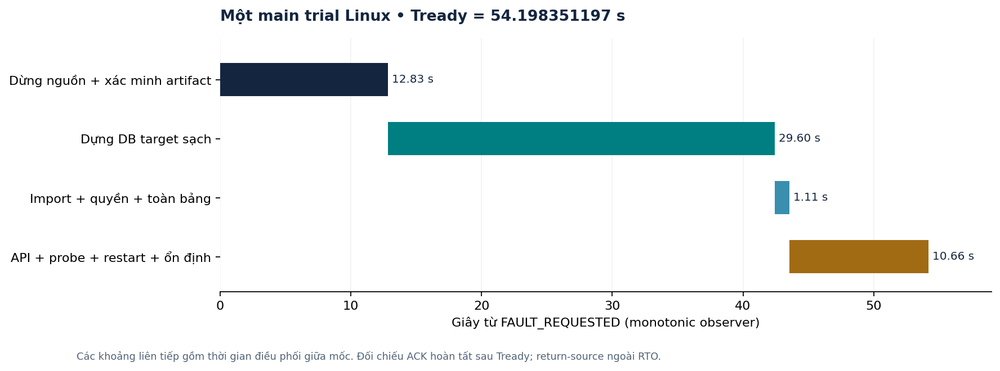

# Thuyết trình Nhóm 08

## 1. Đánh giá khả năng phục hồi
Học phần An toàn thông tin • Nhóm 08 • 15/11/2026

Sự cố mã hóa tống tiền
Mô phỏng an toàn trên lab Docker
Đa Minh • Minh Quân
Flask / MySQL / Restic / SHA-256

Ghi chú thuyết trình: Giới thiệu nhóm và phạm vi. Đây là báo cáo MVP với bằng chứng Linux đã có; không trình bày là đã nghiệm thu Windows hoặc chống được ransomware thật.
Nguồn: THESIS/REPORT_GROUP08.md

## 2. Câu hỏi nghiên cứu
Khi DB không khả dụng, có thể đưa dịch vụ trở lại từ snapshot đã chọn?

- Khả dụng: Đúng URL phục vụ; Health/API hoạt động; Có mốc bắt đầu và ready
- Toàn vẹn: Manifest + SHA-256; Schema và toàn bộ dòng; Kiểm trước write probe
- Mất dữ liệu: Tập request có send/ACK; Đơn khôi phục / còn thiếu; Duplicate và uncertain

Chỉ dữ liệu đơn hàng giả; không mã độc, không xóa bảng hoặc volume.

Ghi chú thuyết trình: Ba câu hỏi khác nhau cần ba loại bằng chứng. Snapshot backup PASS không đủ để kết luận restore PASS. Khả dụng không chỉ là trang chủ trả 200.
Nguồn: BAO_CAO_CAC_PHASE.md; BAO_CAO_CAC_PHASE.md

## 3. Kiến trúc thực thi
MySQL 8.4.7 • lab_config.orders • InnoDB • Compose

- NGUỒN: Flask / Gunicorn; MySQL orders; localhost:8080
- BACKUP: Dump nhất quán; Baseline nghiệp vụ; Manifest SHA-256
- RESTIC: Full snapshot ID; Trusted digest; Check + readback
- TARGET: Stack / volume mới; Không seed; Xác minh rồi phục vụ

Kho và secret vẫn cùng host. Chưa có bản sao độc lập chịu được mất host.

Ghi chú thuyết trình: DB không publish port host. Backend internal, web thêm frontend bridge nên không gọi đây là air-gap. Target không mount volume DB nguồn. Các mũi tên mô tả luồng thiết kế.
Nguồn: compose.yaml; compose.restore.yaml; compose.backup.yaml

## 4. Backup gắn với baseline
Baseline độc lập được capture từ DB nguồn, không lấy từ target vừa restore

- Cửa sổ nhất quán: Dừng web, drain transaction; Không admin writer hoặc DDL; So toàn bảng trước/sau dump
- Artifact được ràng buộc: database.sql + metadata.json; Baseline gắn SHA-256 SQL; Manifest không tự hash chính nó
- Kiểm lại từ kho: Restic check --read-data; Readback đúng snapshot; Chỉ PASS khi mọi kiểm tra đạt

Snapshot cũ thiếu baseline: có thể verify byte; chưa đủ nghiệm thu nghiệp vụ.

Ghi chú thuyết trình: Mysqldump single-transaction phù hợp InnoDB khi không có DDL. Dump chỉ có schema/data orders; không copy trực tiếp /var/lib/mysql và không mang user/grant ứng dụng.
Nguồn: SOURCE/backup/db_dump.sh; SOURCE/recovery/controller.py; SOURCE/recovery/archive.py

## 5. Phục hồi sạch: điều kiện PASS
Project, network và DB volume phục hồi độc lập

- Trước import: Full snapshot ID + digest; SHA hợp lệ, target chưa có; SELECT 1; schema zero table
- Sau import: SQL exit 0, cấp SELECT/INSERT; Schema + hash mọi dòng khớp; API đọc đối chiếu toàn bảng
- Trước ready: Một probe ghi riêng; Restart giữ base và probe; Cleanup + 3 health ổn định

API chỉ trả 100 dòng mới nhất; COUNT và API window không thay kiểm tra toàn bảng.

Ghi chú thuyết trình: Không tự chọn latest hoặc tái sử dụng target dở. Read-before-write giúp probe không làm thay baseline. User và quyền phải tạo lại vì không nằm trong dump orders.
Nguồn: BAO_CAO_CAC_PHASE.md; SOURCE/recovery/controller.py

## 6. Kịch bản chính đã chạy
Một lượt Linux ngày 10/11/2026 • dữ liệu giả, không retry

- Trước snapshot: Nguồn 104 dòng; Một checkpoint có ACK; Snapshot baseline 105 dòng
- Sau snapshot: Thêm 3 đơn có ACK; Drain mọi request; Dừng DB → health 503
- Khôi phục: Volume mới, không đọc nguồn; Target về localhost:8080; Kiểm dữ liệu / API / restart

Return-source xảy ra sau trial, ngoài RTO; nguồn trở lại 108 dòng.

Ghi chú thuyết trình: 105 dòng trong snapshot và 108 dòng nguồn sau trial không mâu thuẫn. Mục tiêu là kiểm chứng phục hồi đến điểm snapshot. Ba tail orders vẫn nằm trên volume nguồn nhưng không được đọc để cứu vào target trong phép thử.
Nguồn: docs/evidence/phase4/main-result.json; main-events.jsonl; acknowledgements.json

## 7. Observed RTO của main trial
T0 trước stop DB; Tready sau kiểm dữ liệu, URL/API, probe, restart, cleanup và stable health

Một quan sát, image cached / cloud VFS. Không phải trung bình nhiều lượt hoặc chứng minh đạt SLA.

Ghi chú thuyết trình: RTO = (SERVICE_VERIFIED.ns − FAULT_REQUESTED.ns)/1e9 = 54.198351197 s. Các khoảng trên biểu đồ liên tiếp, có cả orchestration. REQUEST_COMPARISON_FINISHED đến sau Tready khoảng 0.397 ms; return-source nằm ngoài phép đo.
Nguồn: docs/evidence/phase4/main-events.jsonl; docs/evidence/phase5/export-20261110/metrics.csv

## 8. Dữ liệu được khôi phục đến đâu?
Tập ACK nghiệp vụ: 1 checkpoint trước snapshot + 3 đơn sau snapshot

- 105 dòng nền: Khớp schema và toàn bảng; Probe riêng thêm 1 → 106; Restart target vẫn giữ dữ liệu
- 3 ACK còn thiếu: Ba tail orders sau snapshot; Checkpoint đã được phục hồi; Không gọi missing là sai SHA
- 0 duplicate: 0 uncertain trong lượt đo; Chỉ profile tuần tự không retry; API chưa có idempotency

105 là toàn bộ baseline; 1/4 là membership trong tập request diễn tập. Hai đại lượng khác nhau.

Ghi chú thuyết trình: Không tính probe vào tập đơn nghiệp vụ mất/khôi phục. Không mở API newest 100 rồi kết luận tất cả 105 dòng khớp. Zero duplicate trong lượt này không bảo đảm retry an toàn.
Nguồn: docs/evidence/phase4/main-result.json; docs/evidence/phase5/retained-integrity.json

## 9. Đọc đúng RTO, RPO và backup age
Số đo lấy từ raw events có pin Git; không dùng created_at_utc làm commit time

- RTO 54.198351197 s: MTTD quan sát: 1.986393601 s; MTTD ở đây chỉ một lần phát hiện; Không phải IDS hoặc số trung bình
- Khoảng tuổi commit: 10.518407983–10.532435583 s; Từ send/ACK của checkpoint; Không phải exact RPO
- Các đại lượng khác: Backup age: 0.091588006 s; Import SQL: 0.133908284 s; Target RTO/RPO: NOT TESTED

Ghi chú thuyết trình: Tuổi backup đo từ SNAPSHOT_VERIFIED đến fault không thay RPO. Khoảng commit lag dựa trên yêu cầu tuần tự, ACK trước fault và recovered prefix; thời điểm commit thật không được quan sát độc lập. Nhóm chưa chốt mục tiêu nên không tự đặt SLA.
Nguồn: HUONGDAN.md; docs/evidence/phase5/export-20261110/metrics.csv

## 10. Bằng chứng và loại kiểm thử
Mỗi PASS phải gắn với một phạm vi, môi trường và thời điểm

- Linux thật: Web/DB, backup, clean restore; Schema / dữ liệu / API / restart; Giữ cả lần restore FAILED
- Unit / mock: Guard, ACK, CSV, lỗi đầu vào; Không thay restore thật; Patch guard mới: 29 recovery tests
- Chưa kiểm chứng: Windows và Task Scheduler; Restore mới trong Phase 6/7; Mất host/kho độc lập

CSV có 4 case lịch sử; tái xuất cùng dữ liệu không tạo thêm main trial.

Ghi chú thuyết trình: Phase6 có 76 unit PASS. Phase7 bổ sung resource guard và kiểm lại suite. Kết quả mới chỉ được ghi sau khi có log; slide này không gán Windows PASS từ Linux. Web-only và corrupt-copy không được dùng làm ba main repeats.
Nguồn: BAO_CAO_CAC_PHASE.md; BAO_CAO_CAC_PHASE.md

## 11. Code review: điều gì còn cần xử lý?
Đã chặn direct restore/drill khi host hoặc filesystem Docker không đủ chỗ

- Guard đã sửa: Trước mọi POST / stop nguồn; Dùng số đo host + Docker; Mock không thay Windows thật
- Finding còn mở: Retry / idempotency API; Backup cũ cleanup / log / concurrency; Flask 3.1.2 chưa nâng bản vá
- Phạm vi phải giữ: Nguồn healthy trước scripted drill; verify_retained: còn gap pre-stop; Không đưa action đó vào demo

Phase5 source_unchanged là health/count. Full source hash trước/sau là bằng chứng riêng của Phase6.

Ghi chú thuyết trình: Không xóa hoặc viết lại proof cũ. Cơ chế kiểm retained DB vẫn có resource check muộn; không chạy trong môi trường disk gần đầy. Các finding không đóng bằng việc chỉ viết thêm tài liệu.
Nguồn: LUU_Y_THUC_NGHIEM.md; SOURCE/metrics/verify_retained.py

## 12. Runbook v1.0 → v1.1
Giữ DOCX của Minh Quân; tạo v1.1 Word riêng để nhóm đối chiếu

- Lệnh và target: Bỏ placeholder, full ID/digest; Stack sạch, không import nguồn; Preflight và kiểm native exit
- Nghiệm thu dữ liệu: Toàn bảng thay COUNT-only; Đọc trước probe, rồi restart; URL và thời điểm ready cố định
- Lỗi và hủy: Uncertain → không retry; Giữ FAIL, journal và target dở; Cleanup/return-source ghi riêng

V1.1 đã có tài liệu và launcher; Minh Quân vẫn cần chạy độc lập trên Windows.

Ghi chú thuyết trình: v1.0 còn khung import trong nguồn và công thức RPO lấy tuổi backup. V1.1 tách rõ đo lường và bằng chứng. Không coi tạo được DOCX là đã nghiệm thu quy trình.
Nguồn: THESIS/runbook/Runbook_v1.0.docx; HUONGDAN.md

## 13. Demo tiến độ trong 5–7 phút
Chọn phạm vi đủ điều kiện trên máy thực tế; mặc định ưu tiên bằng chứng đã có

- 1 • Web và kiến trúc: Health/API và đơn hàng giả; Giải thích MySQL + Restic; Không hiển thị secret
- 2 • Bằng chứng phục hồi: Full snapshot và target riêng; 105 base + 1 probe; Schema / full hash / restart
- 3 • CSV và giới hạn: 54.20 s là mẫu Linux cũ; 3 ACK thiếu đúng điểm snapshot; Windows chưa được PASS

Chỉ chạy web-control khi preflight đúng scope PASS và chủ động có cửa sổ diễn tập.

Ghi chú thuyết trình: Đa Minh đề xuất thao tác, Minh Quân giải thích và ghi chép; chưa phải xác nhận nhóm đã thực hiện. Không cài/reset lab giữa giờ bảo vệ hoặc hứa full restore khi gate thiếu disk. Lệnh và cách quay về nguồn ở HUONGDAN.md.
Nguồn: HUONGDAN.md; HUONGDAN.md

## 14. Điều kiện còn thiếu để nghiệm thu
Hồ sơ có thể review; toàn bộ dự án chưa được ký PASS

- Chuẩn bị tài nguyên: Cloud chỉ còn khoảng 132 MiB; Cấp đủ disk cho target mới; Giữ mọi volume và snapshot
- Thực thi Windows: Preflight → backup → restore sạch; API / quyền / full hash / restart; Transcript và review độc lập
- Khép hồ sơ: Nhóm xác nhận số liệu/phân công; Review các PR phụ thuộc; Không tự merge vào main

Independent storage, exact RPO và mục tiêu SLA chưa được chứng minh.

Ghi chú thuyết trình: Tăng dung lượng không có nghĩa xóa volume hoặc snapshot. Sau khi Windows Phase3 PASS mới chạy main drill Windows. Có thể bổ sung nhiều trial khi có nguồn lực, không tạo bản sao log làm các mẫu mới.
Nguồn: BAO_CAO_CAC_PHASE.md; BAO_CAO_CAC_PHASE.md

## 15. Kết luận và trao đổi
MVP chứng minh phục hồi trong kịch bản đã chạy; kết luận giữ đúng giới hạn bằng chứng

- Đã chứng minh: Snapshot → target sạch; Schema / toàn bảng / API / restart; Số đo tái lập từ raw events
- Chưa kết luận: Chống ransomware thực tế; Không mất dữ liệu mọi tình huống; Đạt RTO/RPO mục tiêu
- Hồ sơ để review: Word + PPTX có speaker notes; Runbook v1.1 Word/Markdown; CSV + evidence + code review

Nguồn chính: repository Nhóm 08, Restic v0.18.1, MySQL 8.4, Docker Compose; thư mục tài liệu có trong báo cáo.

Ghi chú thuyết trình: Mời câu hỏi về baseline, trường hợp thiếu snapshot baseline, SQL import fail, dữ liệu không nằm trong API newest100, hoặc cách phân biệt tuổi backup với commit lag. Danh mục nguồn chính thức và paths đầy đủ ở Word/REPORT_GROUP08.md.
Nguồn: https://github.com/daminh12/MaNhom08_DanhGiaKhaNangPhucHoiRansomware
